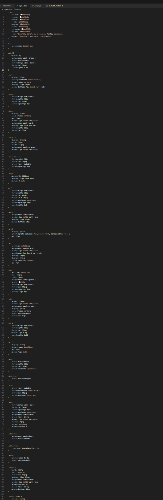
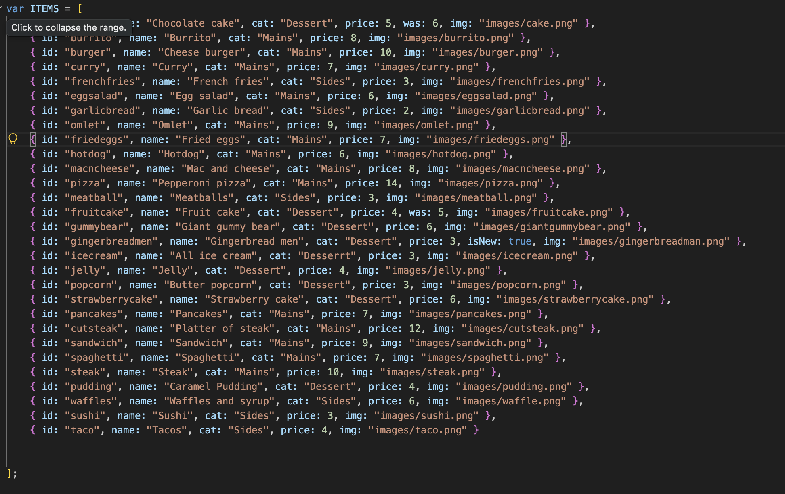
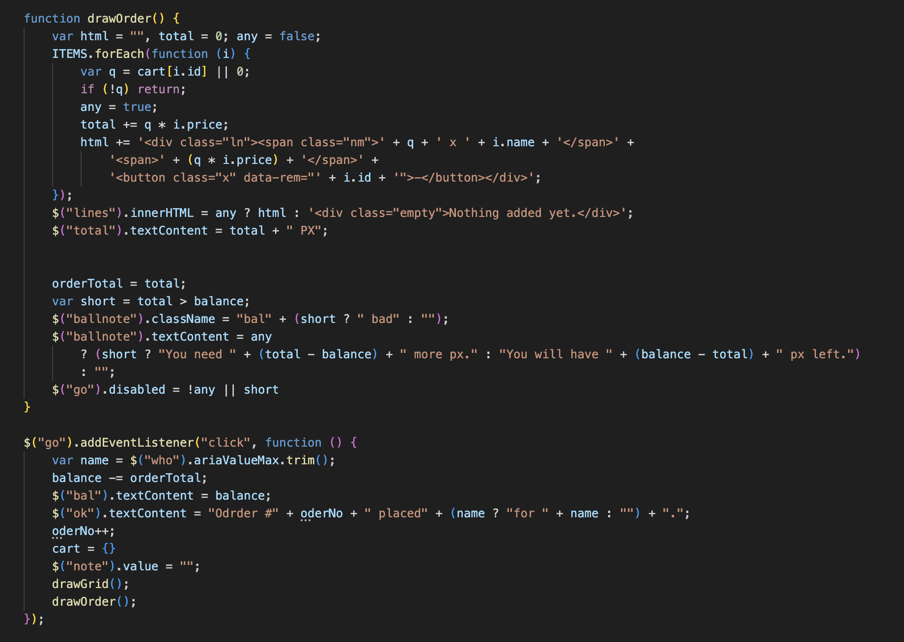

# OrderUp

Description

This is my ordering system for the hack club cafe trial in pixl. I made an ordering system with search and filters to try and replicate the feel of ordering fastfood through an app or website.

Screenshots

css:

it's a lot of css

javascript:

the items on menu:

the ordering logic: 

I used a dictionary with a list of the items with parameters like the price, a was parameter for an original price, a regular name, a name to be displayed, a file path to provide the image, an is new paramter to add a green popup to see if it's new or not.

Getting Started

No dependencies or libraries needed to install, hosted on vercel and just click the link: https://orderup-ten.vercel.app/ to go to the website, you might need to be on the latest version of whatever browser you're using I don't really know.

Help

It should work, otherwise please contact me via hack club slack

License

I didn't get one

Shoutout to ghostpixells sprites on itch.io, they're really good and you should go check them out on itch.io

